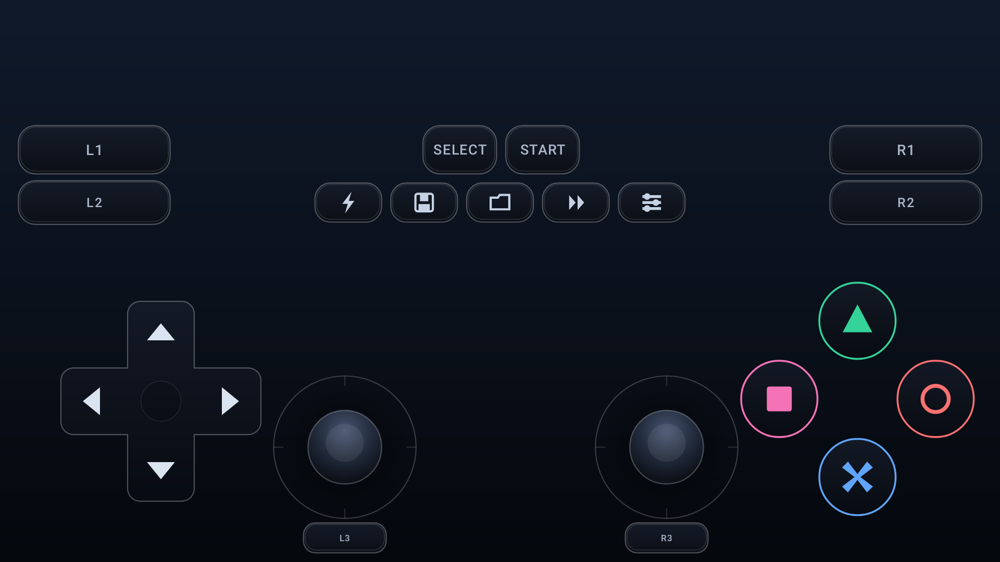

# Downhill Domination — Mobile (Android)

Porta o **Downhill Domination (PS2)** para celular com teclado virtual completo, bonito e
com **emoji em cada tecla**, e traz ajustes prontos para rodar em **GPU fraca (Mali-G52)**.



> **O que este app é, sem enrolação:** um jogo de PS2 não tem "port nativo" real — o que
> existe no Android são **núcleos de emulação de PS2** (ARMSX2 / AetherSX2 / NetherSX2 /
> RetroArch + LRPS2). Este APK é a camada que faltava em volta deles: importa a sua imagem,
> abre o jogo num toque, desenha o pad completo com emoji, exporta esse pad e aplica os
> ajustes de desempenho. É assim que os ports de PS2 para Android funcionam por dentro.

---

## 1. Baixar o APK

Pegue `app-release.apk` na aba **Releases** deste repositório e instale no celular
(Android 7.0+ / `minSdk 24`). O APK é **assinado** e não pede root.

## 2. O jogo

O arquivo que você mandou no TransferNow é:

| Arquivo | Tamanho |
|---|---|
| `Downhill Domination (Europe) (En,Fr,De,Es,It).zip` | 2,42 GB (deflate) |
| `Downhill Domination (Europe) (En,Fr,De,Es,It).iso` | 2,77 GB (dentro do zip) |

Ele **não cabe dentro do APK** (o limite de um asset/release é 2 GB), então o app importa
o zip uma única vez:

1. Abra o app → **Importar ROM (.zip / .iso)** → escolha o zip baixado.
2. O app descompacta em streaming para a memória privada (`downhill.iso`), com barra de
   progresso, checagem de CRC do zip e checagem de espaço livre (precisa de ~2,8 GB).
3. No fim ele lê a estrutura ISO 9660 e mostra o serial: **SLES-52202 (PAL)** — prova que a
   imagem é o jogo certo, e não um zip corrompido.

Para baixar e conferir o pacote pelo terminal: `scripts/fetch-rom.sh`.

### Verificado com o arquivo real

O caminho de importação do app foi executado contra o arquivo do seu link:

```
zip      : 2.421.295.952 bytes
iso      : 2.771.025.920 bytes (extraído em 10,6 s)
crc      : verificado pelo ZipInputStream (nenhum ZipException)
label    : DOWNHILLDOMINATION
boot2    : cdrom0:\SLES_522.02;1
serial   : SLES-52202 (PAL)
downhill : true
```

> Foi assim que o serial correto entrou no código: a primeira versão achava que era
> `SLES-53828` e teria avisado "confira se é o jogo certo" para o arquivo certo. Hoje a
> detecção usa o serial **e** o rótulo do volume (`DOWNHILL`).

## 3. Rodar

1. Instale um núcleo PS2 no celular (o app detecta sozinho e leva na loja):
   **ARMSX2** (mais rápido em ARM), **AetherSX2**, **NetherSX2** ou **RetroArch (LRPS2)**.
2. No app, toque em **▶ JOGAR** — a imagem é entregue ao núcleo por `content://`
   (sem copiar 2,7 GB de novo).

## 4. Otimização para Mali-G52

O app mostra a lista pronta (e copia para a área de transferência). O que mais importa:

| Onde | Ajuste | Valor |
|---|---|---|
| Graphics | Renderer | OpenGL |
| Graphics | Internal Resolution | **1x (nativo)** |
| Graphics | Texture Filtering / FXAA / Shade Boost | Desligado |
| Emulation | **MT-VU (Multi-Threaded VU1)** | Ligado |
| Emulation | EE Cycle Rate / Skip | 100% / 1 |
| System | Sustained Performance Mode | Ligado |

Fora do emulador, o próprio app já ajuda: superfície opaca, sem inflar layout na hora de
desenhar o pad (um único `Canvas`), haptics curtos e nenhuma thread de animação girando à
toa — o contador de quadros do *Pad Lab* existe para você conferir isso na sua tela.

## 5. Teclado virtual

- **21 teclas**: direcional (4), ação (△ ○ ✕ □), ombros (L1/L2/R1/R2), L3/R3, Select,
  Start + 5 extras do app (⚡ Turbo, 💾 Salvar, 📂 Carregar, ⏩ Avançar, ⚙ Menu).
- **2 analógicos** com zona morta, ponteiro preso (o dedo não "pula" de tecla), vibração e
  escala/transparência ajustáveis.
- **Legenda com emoji**: cada tecla com o mesmo emoji que aparece no pad e a função dela no
  jogo (pedalar, frear, pular, socar/atacar, manobras...).
- **Exportar pad**: gera `downhill-pad.cfg` + `downhill-pad.png` + `LEIA-ME.txt` e manda
  pelo compartilhamento — o mesmo pad, agora dentro do RetroArch
  (`Settings › On-Screen Display › On-Screen Overlay › Overlay Preset`).

Mapa usado no RetroArch: `✕→btn_b`, `○→btn_a`, `□→btn_y`, `△→btn_x`, `L1/R1→btn_l/btn_r`,
`L2/R2→btn_l2/btn_r2`, `L3/R3→btn_l3/btn_r3`, `Select/Start→btn_select/btn_start`,
analógicos → `analog_left`/`analog_right`, extras → hotkeys do RetroArch.

## 6. Compilar

```bash
scripts/setup-toolchain.sh          # JDK 17 + Android SDK 34 + Gradle 8.7 em .tooling/
export JAVA_HOME="$PWD/.tooling/jdk-17.0.21+9"
.tooling/gradle-8.7/bin/gradle :app:testDebugUnitTest   # 44 testes
.tooling/gradle-8.7/bin/gradle :app:assembleRelease     # APK assinado
```

Chave de assinatura em `signing/downhill-release.jks` (senha `downhill2026`, alias
`downhill`) — é a mesma que assina o APK publicado nas Releases.

## 7. Estrutura

```
app/src/main/java/com/downhill/mobile/
├── MainActivity.java          # importar, jogar, exportar, ver ajustes
├── PadLabActivity.java        # tela cheia de teste do pad + FPS real
├── legend/LegendActivity.java # legenda com emoji de todas as teclas
├── pad/                       # modelo das teclas, geometria, desenho e toque
├── rom/                       # leitor ISO 9660, importador do zip, content provider
├── emu/                       # detecção dos núcleos + tabela de otimização
└── export/                    # overlay do RetroArch (.cfg) + PNG
```

## 8. Testes

`gradle :app:testDebugUnitTest` roda 44 testes JVM:

- geometria do pad em 8 telas (nenhuma tecla fora da tela, sem sobreposição, hit-test);
- modelo das 21 teclas (emoji, código de gamepad, unicidade);
- leitura do ISO 9660 com imagem sintética (serial EUA/Europa, lixo, outro jogo);
- extração do zip (imagem dentro, iso cru, zip sem imagem, download truncado, cancelamento);
- overlay do RetroArch (formato, faixas 0..1, mapa DualShock→RetroPad, README);
- tabela de otimização e escolha do emulador;
- **Robolectric**: abre as três telas de verdade, desenha o pad (Skia nativo) e confere os
  pixels, gera os arquivos do export e faz um import completo zip→iso→serial.
